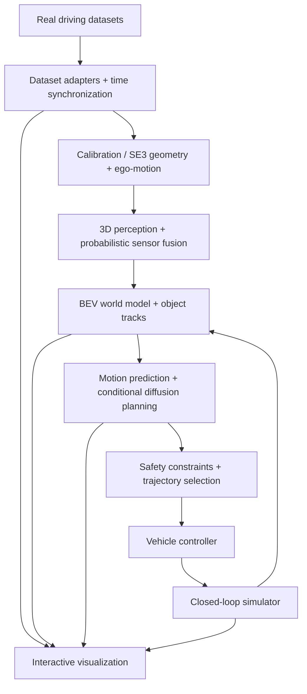

# AutonomousAI-Robotaxi

**Real-world sensor fusion, 3D perception, generative motion planning, and closed-loop city-driving simulation.**

> **Status:** Phase 0 — environment and repository setup. Research/learning project, **not** a road-ready or safety-certified L4 system.

## Project goal

Build an engineering-grade Robotaxi AI prototype that (1) replays **real urban driving data** with synchronized sensors; (2) generates an interactive **front-camera / 3D LiDAR / top-down BEV** display; (3) estimates ego and object states via geometry, calibration and uncertainty-aware fusion; (4) predicts other road users and learns a **conditional diffusion trajectory planner**; and (5) demonstrates continuous route following, replanning, collision checks and vehicle control **in closed-loop simulation**.

We will distinguish **real recorded replay** from **counterfactual simulated driving**. A planner cannot alter the future of a fixed recording. The closed-loop demonstration will be driven by simulated vehicle dynamics and evolving traffic-agent states, with real data used for maps, perception research, and scenario inspiration.

## What the finished demo will show

- **Real-world drive replay:** cameras, LiDAR point clouds, sensor timestamps, ego trajectory and recorded route.
- **3D scene:** rotatable/zoomable point clouds, coordinate frames, optional 3D boxes and map overlays.
- **BEV sensor fusion:** ego vehicle, tracks, velocity, covariance/uncertainty and occupancy.
- **AI prediction:** multiple plausible motions for interacting traffic agents.
- **Diffusion planning:** candidate trajectories, cost/constraint evaluation and selected safe plan.
- **Closed-loop city drive:** route goal, intersections, stationary obstacles, cut-ins, pedestrian interaction, braking, lane changes when feasible, control and replanning.
- **Evaluation:** progress/completion, collision/near-miss proxies, comfort, tracking error, latency and scenario failures.

## Architecture



## Datasets: deliberate separation of roles

| Dataset | Purpose | Important limits |
|---|---|---|
| [Oxford Radar RobotCar](https://oxford-robotics-institute.github.io/radar-robotcar-dataset/) | Long real-world Oxford city traversals: camera, LiDAR, scanning radar, poses/odometry | Start with **selected traversal chunks**; sensor formats/availability vary; scanning radar is not automotive object-list radar. Dataset is research/non-commercial licensed. |
| [nuScenes](https://www.nuscenes.org/) | Short, richly calibrated scenes for camera / 3D LiDAR / 5-radar sensor-fusion experiments | **20-second scenes**; not a continuous long-drive dataset. Start with mini when needed. Non-commercial research dataset terms. |
| [nuPlan](https://www.nuplan.org/) | Planning benchmarks, route/map context, closed-loop scenario evaluation | Benchmark scenarios are not automatically one uninterrupted long route; use selected scenarios first. Check access and licenses. |

**Dataset policy:** Do not commit raw recordings, maps, licensed annotations or pretrained model weights. Follow each dataset's registration, attribution and license terms. This public repo contains code, configuration, instructions, tests and allowed derivative performance summaries, not redistributed datasets.

## Phase plan

| Phase | Engineering deliverable |
|---|---|
| **0 — Foundation** | Git repository, reproducible Python/CUDA environment, unit-test/CI conventions |
| **1 — Real data ingestion** | Oxford traversal reader, timestamps, camera/LiDAR playback and 3D world visualization |
| **2 — Geometry & fusion** | SE(3), extrinsics, motion compensation, ego state, EKF, association, multi-object tracking |
| **3 — 3D scene understanding** | BEV, occupancy, 3D objects and uncertainty visualization |
| **4 — Learned driving AI** | Motion forecasting, small PyTorch models, conditional diffusion trajectories |
| **5 — Autonomous planning** | Routing, behavior, trajectory selection, bicycle dynamics, MPC and safety/fallback |
| **6 — City simulation** | Closed-loop driving, complex traffic scenarios, replanning, fault injection |
| **7 — Demonstration** | Multi-view dashboard, videos, tests, benchmarking and technical portfolio |

Implementation principle: **math → custom algorithm → real data → tests → integration → measured outcome**. No generic Python tutorials. We will prioritize executable engineering over superficial features.

## Development hardware

- **No physical robot, LiDAR, or other purchases required.** This is software-first.
- Windows laptop, NVIDIA RTX A1000 **6 GB** laptop GPU, Python 3.11 virtual environment.
- PyTorch GPU check verified in setup: CUDA-enabled torch and successful GPU computation. `nvidia-smi` is not required for PyTorch CUDA to work.
- Use CPU/reduced-size data for large point clouds; train compact models locally; high-end full-scene simulators or bigger models may require optional remote compute.

## Environment setup (Windows PowerShell)

```powershell
cd C:\GenAI\AutonomousAI-Robotaxi
py -3.11 -m venv .venv
.\.venv\Scripts\Activate.ps1
python -m pip install --upgrade pip
python -m pip install numpy scipy pandas matplotlib opencv-python pillow open3d pyquaternion pytest pyyaml tqdm
# Install CUDA-enabled torch from the appropriate official PyTorch wheel index.
python -c "import torch; print(torch.__version__, torch.version.cuda, torch.cuda.is_available())"
```

For reproducibility, see `docs/ENVIRONMENT.md`; package pins will be captured after validation rather than guessing platform-dependent GPU packages.

## Repository structure (planned)

```text
configs/              # dataset and experiment configuration
src/datasets/         # dataset adapters: Oxford, nuScenes, nuPlan
src/geometry/         # rigid transforms, calibration, synchronization
src/sensors/          # camera, LiDAR, radar interfaces
src/fusion/           # state estimation and tracking
src/perception/       # 3D objects / occupancy / BEV
src/prediction/       # motion forecasting
src/planning/         # diffusion + trajectory selection
src/control/          # vehicle models and tracking control
src/simulation/       # closed-loop scenario engine
src/visualization/    # interactive synced multi-view dashboard
scripts/              # runnable demonstrations
configs/              # settings and experiment configs
tests/                # unit and integration tests
docs/                 # architecture, learning notes and benchmark docs
data/                 # local datasets only; Git ignored
results/              # local results only; Git ignored
```

Only functional modules are added as work progresses. A README item is a **target**, not a claim that the module is already implemented.

## Definition of done for each module

1. Runnable example against a known input.
2. Documented coordinate frames, units, timestamps and assumptions.
3. At least one automated test plus a useful edge case.
4. Visual artifact or quantitative metric with a reproducible command.
5. Clear limitations and expected behavior under sensor errors or missing data.

## Next milestone

**Phase 1:** select a short Oxford Radar RobotCar traversal chunk, inspect the actual sensor files and calibration, and show a synchronized camera + LiDAR 3D + LiDAR BEV view. Expand to long playback after confirming correctness and performance.

## References

- [Oxford Radar RobotCar downloads and SDK](https://oxford-robotics-institute.github.io/radar-robotcar-dataset/downloads)
- [Oxford RobotCar original dataset](https://robotcar.org.uk/)
- [nuScenes dataset](https://www.nuscenes.org/)
- [nuPlan and devkit](https://www.nuplan.org/)

## License and safety

Project source-code licensing is **not yet chosen**. Dataset licenses remain separate. All autonomous driving is simulated/research only; do **not** deploy onto public roads or treat these algorithms as safety-certified vehicle software.
